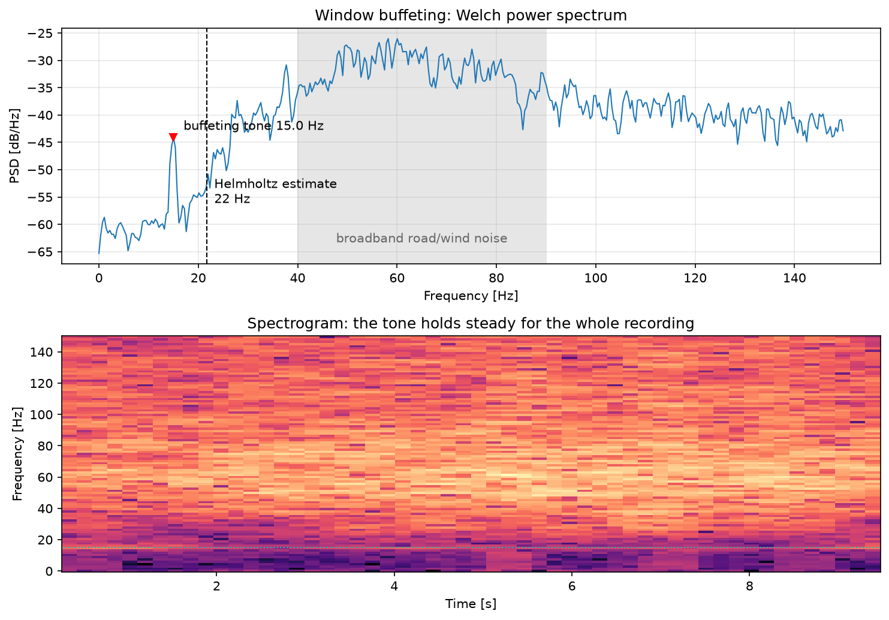
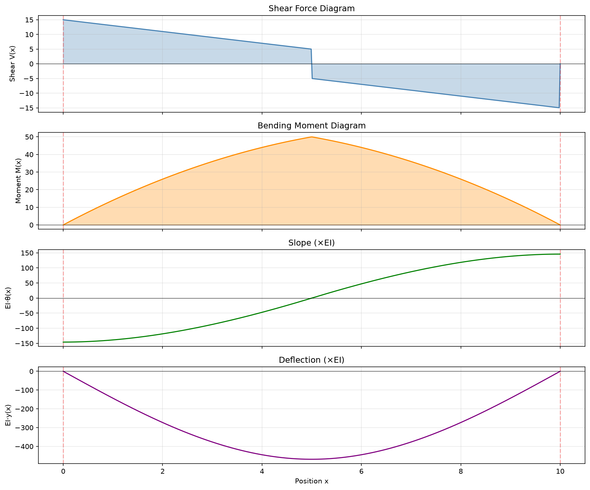

# engineering-analysis-tools

Small command-line tools I use to answer engineering questions from real measurements: spectral
analysis of audio recordings, Strouhal-number scaling, and a symbolic beam solver.

## Investigation: Helmholtz Resonation while driving in car with open window 

Driving with a single window down produces a low, pulsing pressure in the cabin. I recorded
10 seconds of it on a phone ([`data/nz_car_window_buffeting.m4a`](data/nz_car_window_buffeting.m4a))
and ran it through `fft_analysis.py`.



- The full-band spectrum is dominated by broadband road and wind noise between 40 and 90 Hz.
- Under that sits a narrow **15.0 Hz tone, about 17 dB above the local floor**, holding between
  14.6 and 15.4 Hz for the whole recording. That's the buffeting.
- With one window open, the cabin acts as a **Helmholtz resonator**: the air plug in the window
  opening is a mass, and the cabin air volume is the spring. The shear layer over the opening
  sheds vortices that lock onto this resonance. A first estimate using
  f = (c/2π)·√(A / V·L_eff) gives **~22 Hz** for a 2.8 m³ cabin and a 0.18 m² opening, the
  right order of magnitude. The cabin volume and window area are assumed rather than measured,
  and the phone microphone's low-frequency roll-off is likely flattening the true peak.

Reproduce with `python examples/car_buffeting.py`.

## Tools

### `fft_analysis.py`: spectrum of any audio file

Handles phone voice memos (m4a), mp3, wav, flac and more via ffmpeg. Windowed FFT, dominant
frequency, optional Strouhal axis.

```bash
python fft_analysis.py recording.m4a
python fft_analysis.py recording.m4a --strouhal --velocity 10 --diameter 0.05
python fft_analysis.py recording.wav -o spectrum.png
```

### `strouhal_plot.py`: frequency → Strouhal number

St = f·d / v. Works from audio directly or from a CSV of frequency/magnitude, so a measured
shedding frequency can be compared against the St ≈ 0.2 expected for a circular cylinder.

```bash
python strouhal_plot.py --audio recording.m4a -v 10 -d 0.05
python strouhal_plot.py fft_data.csv -v 10 -d 0.05
```

### `beam_analysis.py`: Macaulay's method, symbolically

Solves statically determinate and indeterminate beams for reactions, shear, moment, slope and
deflection using SymPy singularity functions. Supports pins, rollers and fixed ends, plus point
loads, point moments, and uniform or linearly varying distributed loads.

```python
from beam_analysis import Beam, BeamSolver, PointLoad, Support, UDL

beam = Beam(
    length=10,
    supports=[Support(position=0, type="pin"), Support(position=10, type="roller")],
    loads=[PointLoad(position=5, magnitude=-10), UDL(start=0, end=10, magnitude=-2)],
)
solver = BeamSolver(beam)
solver.solve()
solver.print_results()   # reactions and the Macaulay expressions
solver.plot()            # V, M, θ, y diagrams
```



## Setup and tests

```bash
pip install -r requirements.txt   # also needs ffmpeg: brew install ffmpeg / apt install ffmpeg
pytest
```

The beam solver is checked against closed-form results: simply supported beams under a UDL
(5wL⁴/384EI) and a midspan point load (PL³/48EI), and cantilevers under a tip load (PL³/3EI),
a UDL (wL⁴/8EI) and an end moment (ML²/2EI). Those tests caught two real bugs: supports at x = 0
were being silently dropped, and point moments had the wrong sign.
